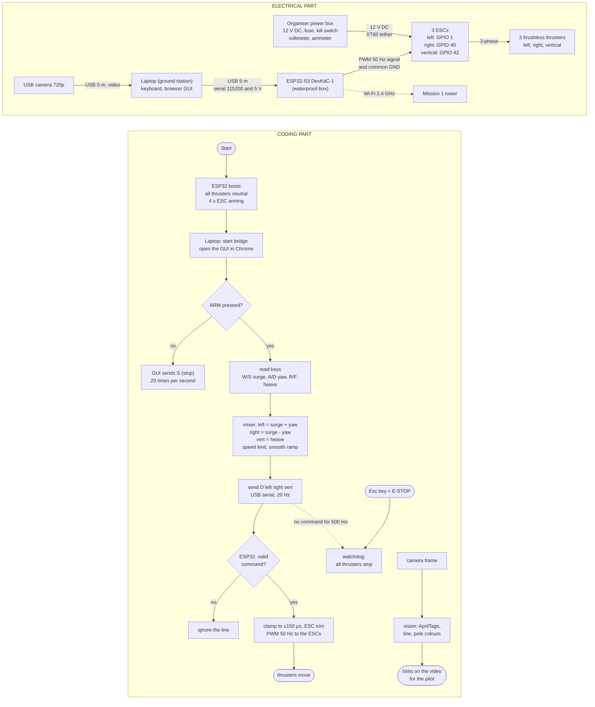
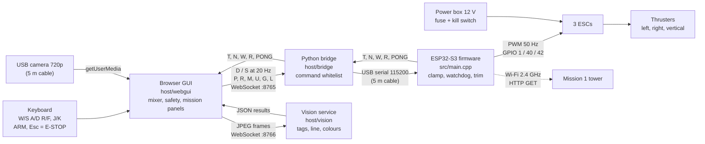
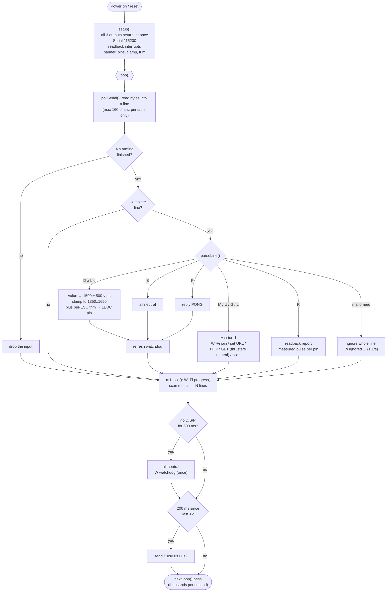
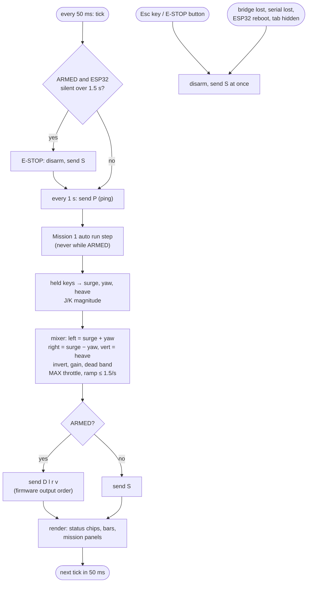
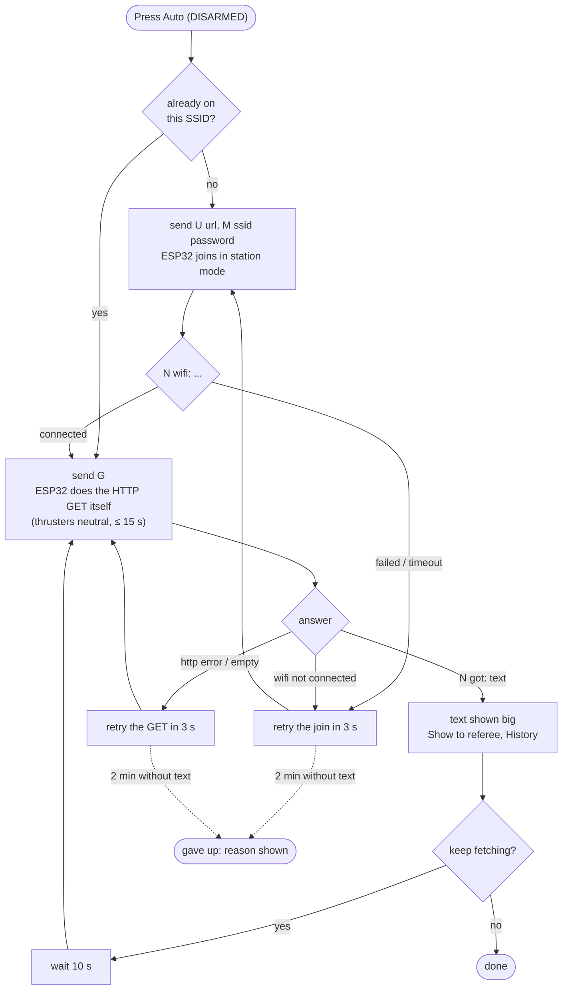
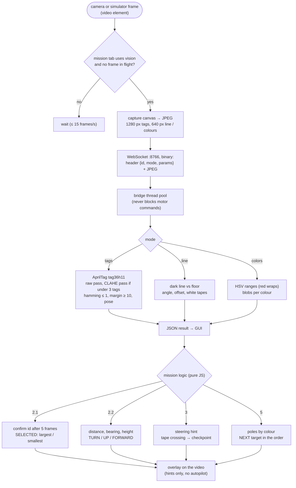

# ROV software: flow charts

Diagrams of the code as it is in this repository (firmware `src/`, bridge `host/bridge/`, vision
`host/vision/`, browser GUI `host/webgui/`). GitHub draws the Mermaid blocks below. The one-page flow chart
for the technical documentation (electrical + coding part) is
[`diagrams/rov_flow_chart.png`](diagrams/rov_flow_chart.png) (also `.svg`), made by
`python3 docs/make_flowchart_doc.py`.

Contracts: [`PROTOCOL.md`](PROTOCOL.md). How to run: [`../host/README.md`](../host/README.md).

## 0. Flow chart: electrical + coding part

## 1. System overview (hardware + software)

## 2. Firmware: main loop (`src/main.cpp`)

## 3. Browser GUI: 20 Hz command loop (`host/webgui/js/app.js`)

## 4. Mission 1: Wi-Fi pairing (Auto: Connect + GET)

## 5. Camera missions: one vision frame

Mission 4 (object retrieval) sends no frames: hook reticle and the 3-second hold timer (`H`) only.
