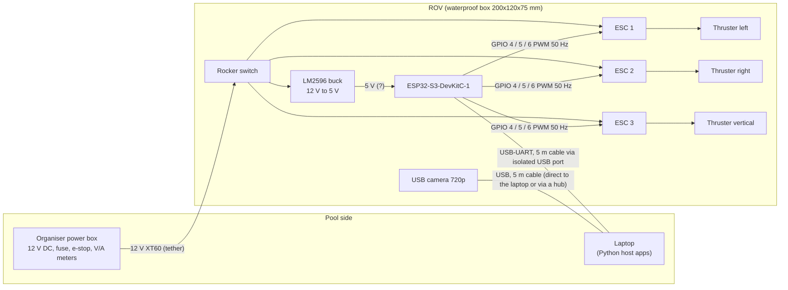
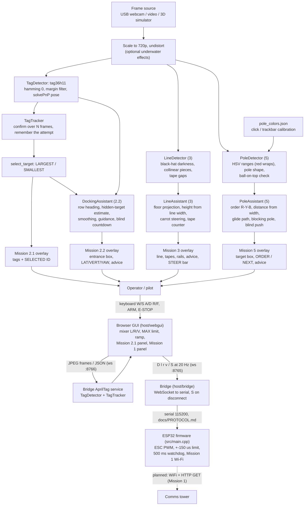

# ROV architecture

Status legend: **done** = in the repo and tested, *planned* = not built yet, (?) = open hardware question.

## Electrical (planned — not wired yet)

Notes: common ground between ESP32 and all ESC signal grounds. Open: ESC bidirectional?, ESP32 5 V from the
buck or from USB (never both without protection), motor dead zone and direction.

## Software data flow

| Part | Where | State |
|---|---|---|
| Tag detection, tracking, 2.1 app | `host/vision/`, `host/mission21.py` | done |
| Docking guidance, 2.2 app | `host/vision/docking.py`, `host/mission22.py` | done |
| Line detection, guidance, tape counter, Mission 3 app | `host/vision/line_*.py`, `host/vision/floor_geometry.py`, `host/mission3.py` | done |
| Pole colour detection, guidance, Mission 5 app | `host/vision/pole_*.py`, `host/mission5.py` | done |
| 3D pool simulator + autopilot check | `host/sim/` | done (docking, line following, poles) |
| Underwater image effects | `host/vision/underwater_sim.py` | done |
| Camera calibration | `host/tools/calibrate_camera.py` | done |
| Browser GUI + bridge: control, Mission 1 panel, Mission 2.1 | `host/webgui/`, `host/bridge/`, `docs/PROTOCOL.md` | done (tested with the mock ESP32) |
| Firmware (protocol, 3 ESCs, watchdog, Mission 1 Wi-Fi) | `src/main.cpp` | done; live ESC test in progress (wiring check with the GUI PIN TEST) |
