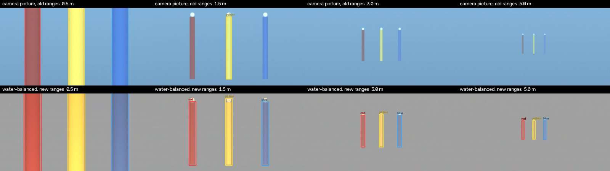

# Mission 5: pole colours under water

> A judge's remark: *"Red can look like another colour under water."* This is true, and it is the
> main risk of a colour-only pole detector. This page explains why it happens, what the detector does
> about it, how we measured the effect, what is still a limit, and how to check it in the pool.



*Simulated pool (normal water, LED lamps, camera white balance locked at the surface). Top: the camera
picture and the old ranges. The red pole goes brown at 1.5 m, and at 3 and 5 m only the yellow pole (or
nothing) is found. Bottom: the same frames after the water-colour balance. All three poles are found
at every distance.*

## 1. Why red changes colour

Three effects stack up:

1. **Water absorbs red first.** Absorption of pure water (Pope & Fry, 1997): 0.34 /m at 650 nm
   (red), 0.057 /m at 550 nm (green), 0.009 /m at 450 nm (blue). Light that crosses 3 m of water
   keeps 36 % of its red, 84 % of its green and 97 % of its blue. Red paint reflects only above about
   600 nm, which is exactly the part the water removes. The light first travels down from the lamps to
   the pole and then across to the camera, so both paths count.
2. **Backscatter adds a blue-green veil.** Particles in the water scatter the lamp light back
   towards the camera. This veil grows with distance and has the water's colour. A far red pole
   becomes "a little red plus a lot of water colour".
3. **The camera's white balance pulls everything around.** In auto mode a webcam tries to make the
   whole picture grey on average. When it is locked, it keeps the colours it had at the surface.
   Either way, the pole's colour depends on the camera's settings and on what else is in view.

In our simulator, with the white balance locked at the surface, the centre of the red pole measured
like this:

| Distance | 0.5 m | 1.5 m | 3 m | 5 m |
|---|---|---|---|---|
| Raw camera hue (OpenCV 0–179) | 0 (red) | 174 (pink-brown) | 159 (magenta) | 107 (**blue**) |
| Raw saturation | 101 | 67 | 24 | 49 |
| Hue after the water balance | 2–6 (red) | 2–9 (red) | 4–11 (red) | 3–14 (red) |

So the judge is right: without a correction, a red pole at 3–5 m is "magenta" or even "blue" to a
fixed threshold.

## 2. What the detector does

The water-colour balance runs in `host/vision/colors.py` (`balance_gains`, `apply_gains`):

1. The picture is shrunk to 64 × 36. In each of the 36 rows, the median B, G and R is the water
   colour of that row. Poles are thin and vertical, so most of every row is water. The water colour
   changes down the picture (green-white towards the surface, deep blue towards the floor), so every
   row gets its own balance.
2. Each row is scaled per channel so that its water becomes neutral grey at level 160. Gains are
   limited to 0.5–4 and smoothed over 3 rows.
3. Then the usual pipeline runs on the balanced picture: HSV ranges, opening and closing,
   connected components. The Mission 5 logic picks the biggest tall blob of each colour.

After the balance, the water is grey (saturation below 10). A pole that is further away becomes
paler, but it **keeps its hue**: the balance takes away exactly the colour the water added.

The default ranges for the balanced picture were chosen on the simulator (§3):

| Colour | H | S | V | Why |
|---|---|---|---|---|
| red | 170..8 | ≥ 45 | ≥ 130 | Red poles stay at H 2–9. **Stops at 8, not higher:** see "neutral objects" below. The V floor keeps black things out. |
| yellow | 18..34 | ≥ 70 | ≥ 80 | S ≥ 70 because white things close to the camera turn pale yellow (S < 75). |
| blue | 95..135 | ≥ 20 | ≥ 40 | The water is grey now, so even a pale, far blue pole counts. |

**Click-to-calibrate** (GUI, 5 Poles → Colour calibration) applies the detector's latest gains to
the clicked pixels, so the click sees exactly what the detector sees. It then **widens the default
range just enough** to include the pole: the median hue ± 3, and the saturation and brightness floors
lowered to 85 % of the pole's own values if needed. It never makes a range narrower.

A single click at one distance cannot know how much paler the pole will be further away. In the
simulator, the old "range from the click" rule made results worse at a distance, and in the balanced
picture it also let grey objects in (431 of 432 frames).

## 3. How we tested it

### The simulator

`host/tests/underwater_sim.py` renders the poles **spectrally** (31 wavelengths, 400–700 nm) with the
simplified Jaffe–McGlamery image formation model, as written by Akkaynak & Treibitz (CVPR 2018):

```
signal(c) = Σλ sensor_c(λ) · [ light(λ, depth) · paint(λ) · shade · e^(−c(λ)·z)  +  veil(λ) · (1 − e^(−c(λ)·z)) ]
```

- **Water:** Pope & Fry absorption plus scattering b (0.03 very clear, 0.1 normal pool, 0.3 cloudy).
  Light reaches the pole through `depth` m of water and is partly bounced off the blue floor.
- **Paints:** typical reflectance curves for red, yellow and blue pigments; a white golf ball; also
  grey, white and black "pipes" as distractors.
- **Camera:** CMOS-like sensor curves with an IR-cut filter, white balance (auto grey-world limited
  like a webcam, locked at the surface, or none), auto exposure, sRGB gamma, noise, blur, JPEG.
- **Scene:** a cylindrical pole with shading, a background of open water or a light-blue tiled wall,
  and a water colour that changes down the picture.

### The sweep (`python -m tools.colors_bench`, from `host/`)

- **Conditions:** 144 = 3 waters × 2 depths × 3 lamps (LED 4000 K, daylight 6500 K, warm 3000 K) ×
  2 white-balance modes × 2 backgrounds × 2 water gradients.
- **Distances:** 7, from 0.5 to 5 m, with all three poles side by side at each one.
- **Scoring:** a pole is **ok** when the Mission 5 pick for its colour is on it.
  - *missed:* no blob of that colour at all.
  - *wrong:* that colour's pick is somewhere else.
  - *confused:* another colour's pick is on this pole.

**% of conditions where the pick is the right pole**:

| Variant | Colour | 0.5 m | 1 m | 1.5 m | 2 m | 3 m | 4 m | 5 m | wrong + confused |
|---|---|---|---|---|---|---|---|---|---|
| **before**: raw camera, old defaults | red | 78 | 51 | 38 | 33 | 33 | 18 | 15 | 0 |
| | yellow | 100 | 85 | 83 | 78 | 45 | 35 | 26 | 2 |
| | blue | 35 | 28 | 23 | 17 | 15 | 15 | 15 | 13 |
| **before**: raw camera, calibrated by clicking at 1.5 m | red | 89 | 92 | 83 | 83 | 65 | 33 | 17 | 0 |
| | yellow | 100 | 100 | 99 | 96 | 69 | 38 | 33 | 79 |
| | blue | 100 | 100 | 99 | 88 | 61 | 43 | 23 | 113 |
| **now**: water balance, new defaults | red | 100 | 100 | 100 | 100 | 88 | 66 | 51 | **0** |
| | yellow | 100 | 100 | 100 | 100 | 100 | 67 | 67 | **0** |
| | blue | 100 | 100 | 100 | 100 | 100 | 72 | 67 | **0** |
| **now**: water balance + click calibration | red | 100 | 100 | 100 | 100 | 88 | 67 | 53 | **0** |
| | yellow | 100 | 100 | 100 | 100 | 100 | 67 | 67 | **0** |
| | blue | 100 | 100 | 100 | 100 | 100 | 72 | 67 | **0** |

What this shows:

- **Out to 2 m, every pole is found in every condition**, and out to 3 m every one except red in
  cloudy water.
- **A pole is never reported as another colour** (0 wrong or confused out of 9,072 pole checks).
  Before, there were 192 such mistakes even after calibration. Past 3 m a pole may simply be *missed*
  (too little light of its colour is left). The pilot then sees `SEARCH` and comes closer, which is a
  safe failure.

Also checked by `tests/test_vision_underwater.py` (it runs in CI on every push):

- dark and bright exposure, JPEG quality 40, three times the sensor noise, blur, no white balance,
  and 1280 × 720 frames;
- a single pole 20–30 cm from the camera;
- empty water and walls never producing a pole;
- the balance itself: the water comes out grey at level 160 in every row.

## 4. What is still a limit

1. **Grey, black and white objects close to the camera look warm after the balance.** They have
   less blue water in front of them than the background, so they turn orange (grey or black) or pale
   yellow (white). The red hue limit, the red brightness floor and the yellow saturation floor keep
   most of them out.
   - Worst case: a pole-shaped pipe alone at 0.4–1.5 m. It is still picked as a colour in
     9 % of frames (grey 66, white 16, black 37 out of 432 each).
   - For comparison: the raw-camera ranges after calibration picked 40 grey, 1 white and 94 black (10 %).
   - The pilot sees the video and the box, so check that the box is on the pole.
2. **Beyond 3 m in cloudy water, red is missed.** No method can bring back light that the water has
   absorbed. Come closer.
3. **A blue pole in front of a wall painted the same blue is invisible to any colour method.** It is
   then missed, never mistaken for another colour. Pool tiles are lighter, so this is unlikely.
4. **Something covering more than about half of the picture's width** makes the median of that row
   its colour instead of the water's. A pole fills that much only in the last ~10 cm before the hit,
   when the approach is already "forward".
5. **Skin and orange objects** (a diver's legs, another team's orange robot) are orange-red in any
   method. The tall-shape preference helps, but it does not exclude them.
6. **The simulator is not the pool.** The physics and constants are textbook values, and we chose
   them to be *worse* than a normal pool. Our pole paint, the real lamps and the camera are
   still unknowns. **The only proof is the pool check below.**

## 5. Pool check (adjustment period, about 5 minutes)

1. Start the bridge and the GUI, then open the **5 Poles** tab with the real camera.
2. Put all three poles in view at about **1 m, 2 m and 3 m**. Each pole must get its own box with
   the right label. Do this once with the robot near the surface and once near the floor.
3. For each colour, tick **Show mask**: only that pole may light up, not the water, the floor or the
   golf balls.
4. Point the camera at anything grey, white or black nearby (the tether, a weight, a PVC frame). Note
   whether it gets a box, and how big that box is compared with the poles.
5. If a pole is **not** found at 1–2 m, press **Sample: click the pole** and click it. The range only
   widens, so this is safe. Repeat step 2.
6. Record a short video of steps 2–4 with the GUI screen recording. It can be replayed through the
   detector later and is evidence for the judges.

## 6. Answer for the judges (30 seconds)

> "Yes: water absorbs red about 35 times faster than blue, and it adds a blue-green haze. Without a
> correction, our red pole measured pink-brown at 1.5 m and blue-ish at 5 m. So before looking for
> colours, our detector measures the water colour in every row of the picture and balances the image
> so the water becomes neutral grey. Then red stays red: hue 2 to 9 out to 3 metres.
>
> We checked it on a physics-based simulator, using water absorption by wavelength, backscatter,
> three lamp types and two camera white-balance modes: 144 pool conditions at 7 distances. Every pole
> was found out to 2 metres. Out to 5 metres a pole was never called the wrong colour; at worst it is
> missed, and the pilot moves closer. Before the change, the same test gave 192 colour mix-ups.
> In the adjustment period we check the masks in the real pool."

## References

- R. M. Pope, E. S. Fry, *Absorption spectrum (380–700 nm) of pure water. II. Integrating cavity
  measurements*, Applied Optics 36(33), 1997. (Water absorption values used in the simulator.)
- D. Akkaynak, T. Treibitz, *A Revised Underwater Image Formation Model*, CVPR 2018. (Direct signal
  plus backscatter, with different attenuation for each.)
- J. S. Jaffe, *Computer modeling and the design of optimal underwater imaging systems*, IEEE Journal
  of Oceanic Engineering 15(2), 1990; B. L. McGlamery, *A computer model for underwater camera
  systems*, SPIE 0208, 1979.
- C. O. Ancuti, C. Ancuti, C. De Vleeschouwer, P. Bekaert, *Color Balance and Fusion for Underwater
  Image Enhancement*, IEEE Transactions on Image Processing 27(1), 2018. (Red-channel compensation and
  white balance before any other processing.)
- G. Buchsbaum, *A spatial processor model for object colour perception*, Journal of the Franklin
  Institute 310(1), 1980. (Grey-world white balance; ours is a per-row, median, water-only variant.)
